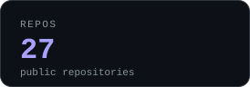
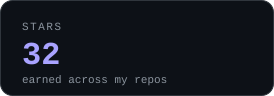
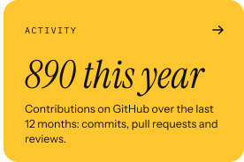
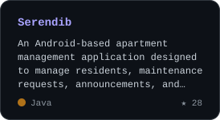
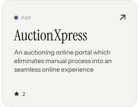
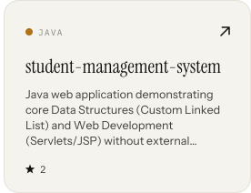

  

  

  

  

  <picture>
    <source media="(prefers-color-scheme: dark)" srcset="cards/title-projects-dark.svg">
    
  </picture>

  

  <a href="https://mohamedshiras.dev">mohamedshiras.dev</a>  /  <a href="https://www.linkedin.com/in/mohamedshiras">linkedin</a>  /  <a href="https://instagram.com/chiya.forsure">instagram</a>  /  <a href="mailto:mhdshiras.dev@gmail.com">email</a>

