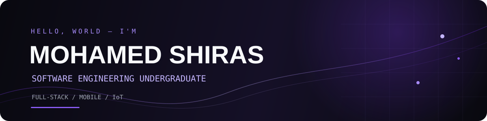
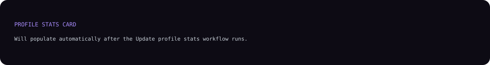

<!--
  Mohamed Shiras — GitHub Profile README
  Repository name must be: MohamedShiras/MohamedShiras
-->

<div align="center">



<a href="https://mohamedshiras.dev"></a>
<a href="https://www.linkedin.com/in/mohamedshiras/"></a>
<a href="mailto:mhdshiras.dev@gmail.com"></a>

<br/>

[](https://git.io/typing-svg)

</div>

---

## `whoami` — A little about me

```ts
const shiras = {
  name: "Mohamed Shiras",
  location: "Sri Lanka 🇱🇰",
  education: "Software Engineering @ NIBM",
  focus: ["Full-Stack Development", "Mobile Apps", "IoT"],
  languages: ["Java", "Dart", "Python", "JavaScript"],
  currentlyExploring: ["Spring Boot", "Flutter", "Modern Web Development"],
  motto: "Build useful things. Keep getting better."
};
```

I’m a Software Engineering undergraduate interested in building reliable web and mobile applications, backend services, and connected IoT solutions. I enjoy working across the stack — from designing APIs and data models to building interfaces and integrating hardware.

## `stack --list` — Technologies & tools

<div align="center">

**Languages**  


**Backend & Frameworks**  


**Mobile & Frontend**  


**Databases & Cloud**  


**Tools & Platforms**  


</div>

## `ls ./featured-projects` — Selected work

<table>
<tr>
<td width="50%" valign="top">

### 🪖 Safe Ride — Smart Helmet

IoT-enabled safety system designed to detect accidents and send emergency information. Combines an ESP8266-based helmet device, GPS and a Flutter application.

`Flutter` `Firebase` `ESP8266` `GPS` `IoT`

[Repository](https://github.com/mohamedshiras/safe-ride)

</td>
<td width="50%" valign="top">

### 🏥 CareLink

Healthcare coordination platform with patient, doctor, nurse and admin roles, including wellbeing status, medication adherence and alerts.

`Full-Stack` `REST API` `Database`

[Frontend](https://github.com/MohamedShiras/CareLink-frontend) · [Backend](https://github.com/MohamedShiras/careline-backend)

</td>
</tr>
<tr>
<td width="50%" valign="top">

### 🏢 Serendib Residence

Android apartment-management application for residents, maintenance requests, announcements and shared-facility reservations.

`Java` `Android` `Supabase`

[Repository](https://github.com/MohamedShiras/Serendib)

</td>
<td width="50%" valign="top">

### 🛍️ HKZ Mart

E-commerce website for handmade gifts and accessories, with Firebase-backed functionality.

`HTML` `CSS` `JavaScript` `Firebase`

[Website](https://hkzmart.live)

</td>
</tr>
<tr>
<td width="50%" valign="top">

### 📅 Resource Reservation Management

Full-stack resource reservation system built as a software engineering technical assessment.

`Full-Stack` `PostgreSQL`

[Repository](https://github.com/MohamedShiras/resource-reservation)

</td>
<td width="50%" valign="top">

### 🌸 MalKade

A floral storefront interface created as a frontend UI challenge, with a refined, luxury-inspired visual direction.

`React` `CSS`

[Repository](https://github.com/MohamedShiras/MalKade)

</td>
</tr>
</table>

## `git stats` — GitHub activity

<div align="center">




</div>

## `contributions --visualize` — Contribution snake

<div align="center">


</div>

## `connect` — Find me online

<div align="center">

<a href="https://mohamedshiras.dev">Website</a> ·
<a href="https://www.linkedin.com/in/mohamedshiras/">LinkedIn</a> ·
<a href="https://github.com/MohamedShiras">GitHub</a> ·
<a href="https://www.instagram.com/chiya.forsure/">Instagram</a> ·
<a href="mailto:mhdshiras.dev@gmail.com">Email</a>

<br/><br/>


**Open to learning, building, and collaborating on meaningful projects.**

</div>

---

<div align="center">

<sub>Designed & built by Mohamed Shiras · Keep shipping 🚀</sub>

</div>
